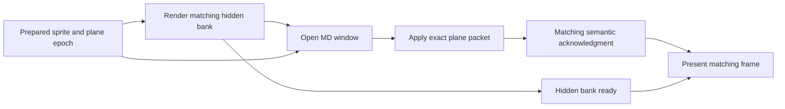

# Committed foreground projection: host reference component

The renderer needs the foreground mask belonging to the background that will
actually be displayed. A live native tilemap or a packet-copy acknowledgment
does not establish that relationship. The normal06 investigation proves a
completed sprite punch can use scroll951 while the MD displays scroll950.
The private ACK-before-flip experiment leaves the mismatch unresolved.

`r60_committed_plane.h` models the missing projection independently of runtime
timing. It takes separate committed NT and identity arrays, ordered NT/art
operations, final scroll values, and explicit per-cell priority eligibility.
The two arrays are each 4 KiB; the interface does not require an additional
interleaved copy. Existing game arrays still have producer meanings and have
not been converted into these committed mirrors.

The identity retains physical tile code, validity and eligibility separately.
Ineligible cells keep their physical identity. MD slot zero means blank;
physical tile zero in another slot remains valid. Art-only slot replacement
updates cells even when no NT word changes. Every supplied pattern must have
its actual zero/nonzero pixels verified; current allocator tags are insufficient.
Unsupported flips, sentinels and missing provenance decline projection.

The reference produces 1,189 tagged foreground words. It does not allocate
storage, publish a frame, update committed state or acknowledge a transaction.
Its operation list and callbacks must remain immutable. Cancellation prevents
publication. Its reference algorithm is not a target performance implementation.

The local sanitizer suite passes 7,239,680 pixel comparisons and 11 negative
controls. The independent full-memory oracle passes 281 cases and 20,545,920
comparisons, using full 64 KiB MD VRAM and VSRAM. Captured packet
replays supply explicit fixture eligibility and opacity-witness tile IDs;
they do not recover historical native identities or prove live admission,
application or displayed-frame ownership. The packet reader's conditional
body semantics and shim-admission limits are recorded in its test documentation.

A separate private diagnostic now captures real source provenance and historical
source-packet bytes. Its read-only headless extension passes exact canonical
120-, 451- and 1,800-frame trace/memory comparisons. At 1,800 it captures 2,228
bodies and joins every ART payload to its actual serialization address, slot
and key. All 2,528 foreground patterns match native opacity. It recovers known
eligibility for 18,578 serialized FG NT words, including 6,379 eligible words.
Background opacity mismatches and nonphysical solids remain explicit declines.
This supplies real source metadata rather than inferred witness IDs, but still
does not establish packet publication, MD admission/application, an initial
committed plane baseline or a displayed sprite/plane cohort. No global projector
fixture is fabricated from those missing certificates. Evidence is under
`build/codex-sprite-block-audit/provenance-observer/` and
`provenance-body-hook/`.

The generic `r60_nt_export.h` is now a host-validated component. For the current
simple-span NT format it validates the complete NT grammar before writing,
then removes CPU eligibility bit15 only from cell payloads. Headers, ART,
palette and rounded padding remain exact; malformed or unsupported layouts
decline without output. SH callers must supply a canonical physical-address
hook for alias checks. It uses no persistent storage.

`python3 tests/diagnostics/check_nt_export.py` passes the portable sanitizer
suite. Optional `--capture-dir` replays all 2,228 historical source bodies.
This does not enable a producer or export caller: runtime integration still
needs immutable source/destination ownership, combined A/B validation, direct
landing validation and a bounded abort/publication policy. Eligibility alone
does not certify ART opacity or actual MD application.

The next runtime contract is still pending:

Native game ticks continue independently. Integration must retain exact staging,
pins and provenance until semantic application; bind all KEEP/raw/punch/block
work to the frozen view; and handle timeout, frontend and reset invalidation.
Neither cleared packet magic nor the existing generic COMM0 counter is that
semantic acknowledgment. No renderer caller, new runtime allocation or hardware
speed improvement follows from this host component.

For the first integration, allow one plane transaction in flight. Finalize its
viewport once; keep its packet, cell eligibility and shipped-art provenance
immutable through application. Copy that exact packet at the accepted sprite
pass's start before releasing staging. The current copy-complete marker is not
permission to mutate a transaction that MD has not applied. Preserve old actual
slot references and protect new in-flight references, with explicit overflow
and cancellation handling.

The existing FG halves of `r60_nt_shadow` and `r60_nt_prev` are candidate storage
for committed NT and resolved identity. They cannot retain their current
producer/rollback meanings at the same time. Stale and art-fit fallback must
preserve actual cell provenance. Slot replacement can change an unchanged NT
cell, and a reused BG pattern need not preserve foreground opacity. These cases
must be covered before migrating those arrays.

A semantic acknowledgment must name the exact applied epoch and report fresh,
empty, skipped, deferred or incomplete packet outcomes. Its publication must
follow relevant VDP application. Timeouts must not certify a partial update or
advance the committed mirror. Frontend writes and reset invalidate the epoch.
An epoch or hash alone does not prove content ownership; live pointers and
unbounded token reuse remain invalid.

Evidence lives under `build/codex-sprite-block-audit/committed-plane-projector/`,
`fg-projector/` and `presented-plane-binding/`. Tests are
`check_committed_plane.py` and `check_fg_projector_oracle.py`.
