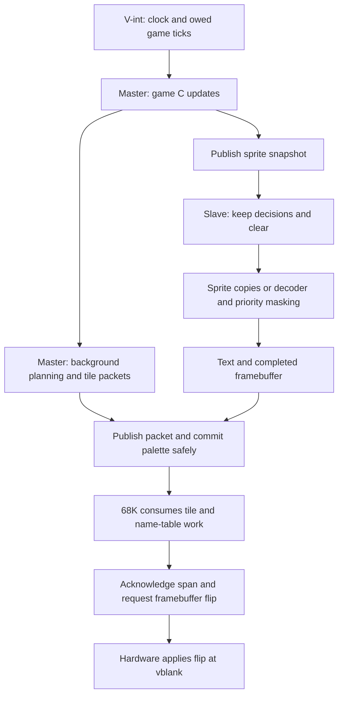

# V-int, C hot paths, and larger baked blocks

2026-11-06. Baseline is play-accepted p15bpt7, not the older transparency builds.
This pass measures and locates work; no production speed optimization has shipped.
Normal p15bpt7 was restored after the probe; ACTIVEGAME and remote SHA256
661f907492dfba6d68ee5f70ca289f497536e1f291c4ad0f1dff89ed0af09a3e verified.
Instrument sourcee5d65c30; analysis toolsef70d9b8. perf04 was built from those
then-uncommitted changes on3f9e9c9b; identify the measured ROM by its SHA/flags. Full evidence: `build/codex-perf01/`.

## What the interrupt actually does

The C V-int handler advances counters, queues owed game ticks (`pp_due`), maintains
presentation bookkeeping, and declines unsafe publication. It does not draw the
sprite list or walk background tiles. `sh_src/mars_start.s:main_v_irq` saves the
caller-saved registers, calls C, restores them, and returns from the interrupt.

This is an overview of the normal play path. Blank/load holds have extra rules;
publication still requires the relevant work to be complete. Keep game simulation
at its arcade tick rate while changing how rendering commands are prepared.

## Hardware measurement

`perf04.32x` = p15bpt7 rendering/game flags plus GOD, the embedded level1_full
input tape, R60RIGSPLIT=3, visible bars, frontend disabled only in this probe.
No frozen fixture, forced form, forced round, pen-ID palette or enemy-clear flag.
perf01..03 were instrument-development probes; onlyperf04 has the final verified
wide encoder plus C ISR timing. Do not interpret earlier mode3probes as IRQ data.
SHA256 f90bebad341b5385b2c711671dabd23d21c5df84e1df9854fd3248dff13d5baf.
Normal p15bpt7 retains its frontend, live controls and normal lives.

Office MiSTer:67 captures with valid32-pass window markers, no saturated rows,
roughly35..520seconds on the automatic route. Actual screenshot timestamps span
02:09:44..02:17:46; launch log02:08:58. Durations below are window averages,
quantized down to8scanlines, not independent single-frame observations, peaks,
or a cadence video. Elapsed phase time includes memory/bus stalls; PEN waits
inside palette commit are not part of the separate explicit wait buckets.
Maxima in different rows can occur in different windows; do not add maxima.

| Slave phase | Median sampled window, lines/pass | Largest sampled window mean |
| --- | ---: | ---: |
| Sprite plot/copy |120|344|
| Priority punch |32|80|
| Clear |24|56|
| Text |8|24|
| Accounted work excluding wait buckets |280|544|
| Wait buckets |168|256|

One NTSC frame is262scanlines. Median observed pass interval is about1.77vints;
largest sampled window mean2.90. These count render passes, not a guarantee of
unique displayed frames during holds. Rounding can report0.977for a true1.0vint.

The measured C V-int body interval is1048..1232CPU cycles, median1144, about0.3%
of the roughly384kCPU-cycle frame budget. It includes the body call/return and
FRT read boundary, excludes the assembly interrupt prologue/epilogue and meter
bookkeeping. It is already included in master elapsed phases: do not add twice.
The probe moves this handler to its existing diagnostic SDRAM placement.

Master elapsed-window shares:

| Phase | Median | Largest sampled share |
| --- | ---: | ---: |
| Game tick |40.8%|64.5%|
| Plane preparation |37.0%|42.7%|
| Idle |18.7%|35.9%|

Minimum sampled master idle is1.5%. The two CPUs overlap; adding their times
would be wrong. Moving more work to the master must be priced in heavy scenes,
not justified by a light-scene idle sample. Cart and SDRAM traffic can affect both.

Result: sprite plotting is the largest rendering cost. Masking/clearing are
next opportunities. The heaviest measured plot alone exceeds262lines, so better
masking by itself cannot make every sampled scene fit one frame. The C interrupt
body is not the primary target. Frontend and timing instrumentation alter the
probe: these measurements establish priorities, not normal-build FPS or a gain.

## Instruments were verified before using their numbers

The old2-line plot scale capped at638lines and some totals capped earlier.
Mode3 displays all slave durations/intervals at8lines per pixel; master shares
retain their /262 units. Row219 reports mean C ISR FRT ticks (8CPU cycles each).
RSX65/66/67 hold sum/count/max;68/69 are the window snapshots. No prior writers
occupied them. `tools/rig_split.py --wide` restores the units and flags saturation.

A real encoding bug was found: shrinking bars cleared a partial tail with zero
BYTE stores, which do not erase the old framebuffer byte. Three rows in the
initial wide probe read too long by1..3pixels. The paint now writes the whole
partial longword. In perf04, all28PNG row lengths equal the stored counters,
verified numerically from a cold ares3600 dump. Evidence irq-reader-proof.json.
This validates encoding, not ares as a hardware speed model.

Probe link guards: _end06017220, RAMTEXTend06037e00, hot region2 ends06018e20,
39hot functions and802dispatch rows retained. Quantcheck65536PASS. With normal
p15bpt7 flags, old/new preprocessed renderer sources match exactly; the code
changes are diagnostic-only. No production gameplay change needs to be inferred.

## C/assembly paths to work on

| Work | Source entry points | Interpretation |
| --- | --- | --- |
| Interrupt |r60_main.c visr_vbi / r60_vbi_body; mars_start.s main_v_irq|Clock, not rasterization; low priority for speed work.|
| Game update |port_l2.c port_play_tick, port_object_dispatch, port_call68_at|Master budget matters in heavy scenes; preserve register publication and arcade state.|
| Plane preparation |r60_main.c r60_planes_prepare; r60_planes.c r60_walk_plane, r60_claim, r60_art|Repeated per-cell resolution, residency/pins, pen mapping and packet preparation.|
| Sprite plot/copy |r60_main.c r60_bk_sprite, r60_sprite; bkcopy.s r60_bk_rows|Largest hardware phase. Fewer decode/color/setup operations and less overlapping framebuffer work are candidates.|
| Priority masking |r60_main.c r60_punch2, r60_prio_mask|Repeated8x8cell lookup, mask resolution, empty-row iteration and stores. Larger composed masks are a candidate.|
| Clear planning |r60_main.c r60_clr_pre / r60_clr_emit / r60_clr_run|Existing span/extent optimization already exists. Avoid reintroducing full-canvas clears.|

A separate deterministic interpreter profile subtracts frame2400 counts from
frame3600 counts. It locates EXECUTED code, not FPGA elapsed time. Main loops
include busy waits and must not be ranked as productive work. Timer helpers
are instrumentation overhead. Linker aliases (_start, __ramtext2_start,
__locktext_end) were resolved to their real functions and cross-checked in the ELF.

In that window: master r60_walk_plane executes about48k instructions/vint,
port_object_dispatch6.8k, recolour/prepare about4.5k each. Slave baked rows57k,
clear preplanning30k, punch24k, speech pump17k. The hardware phase split, not
these instruction counts, decides which work to prioritize.

The two runtime dispatch sites both binary-search the802-row handler table.
Only16distinct physical dispatch thunks execute in this20-second window, about
19.15entries/vint. A bounded lookup cache is a reusable engine candidate, but
this is not an ordered access trace or a cache-hit measurement. Do not forecast
FPS from it or rank it above the measured rendering costs without an A/B.

## Larger squares: what the data supports

The source8x8tile format does not dictate the C work unit. The MD VDP continues
to consume8x8patterns, but preparation/cache lookup/priority work can use larger
assembled blocks. Larger groups do not automatically reduce pixels transferred.
They can amortize repeated lookup/setup and, where composition removes overlap,
reduce stores. Native palette/priority/layer/scroll behavior remains the output bar.

`tools/tile_block_census.py` measures10native snapshots across level1 using the
current port's13-page shadow and configurable bank offset. Inputs were preserved
under census-inputs with hashes. This is structural source data, not a runtime
cache-hit estimate, working-set union assumption, or a whole-game coverage claim.

| Block size | Unique nonblank source keys across both planes | Raw4bpp source-block bytes | Largest visible FG mask+full-source-key footprint |
| --- | ---: | ---: | ---: |
|16x16|1133|145024|3360|
|32x32|513|262656|3520|
|64x64|186|380928|3840|

Raw art sizes exclude indices/headers and palette-map variants. In this simple uncompressed source-key layout, larger full graphics blocks
cost more in these samples; pixel deduplication/compression could change that. The mask case is more
promising: a32x32mask is128bytes plus32bytes for16source keys; at most22priority
blocks cover the sampled viewport. The existing per-tile mask+tag arena is10KiB.
This is a capacity comparison, not evidence that all blocks fit the SH-2's4KiB
shared instruction/data cache or that building them is free.

## Next experiments, in priority order

1. **Plot work:** price a zero-bank raw-copy fast path and common assembled sprite
   poses/regions. Palette-bank0 needs no bank-color arithmetic. Precolored or
   multi-part bakes need measured frequency/storage and a runtime mapping guard.
   Keep literal zero transparent. Full overlapping body/head fixtures are required.
2. **Composed16x16 vs32x32priority masks:** cache world-aligned, palette-independent
   occupancy; clip it per draw region while retaining sprite/layer ordering. Compare
   metadata work and framebuffer writes separately. Establish invalidation for source
   writes, page selection and MCU tile-bank changes; scroll alone should not require
   rebaking unchanged world art. Current dirty-page/load/FG generation signals are
   starting points, not proof that every write has been covered. Test actors under
   opaque and transparent FG cells; the prior above-ground overlap fixture alone
   would not validate masking.
3. **Larger plane preparation blocks:** retain the canonical small-tile descriptors,
   reuse grouped lookup/packet data for static regions, and fall back for dynamic
   pieces. Keep A/B layers and scroll contexts separate. Colored cached art must key
   on resolved pen-map generation as well as tile codes/bank/attributes. Mask blocks
   avoid palette variants and are a lower-risk first use of the larger-block idea.
4. **Small pure lookup caching in the port runtime:** measure dispatch order/hits
   before replacing searches. Reuse one engine lookup path and preserve all miss
   diagnostics and register handoff. Do not special-case Altered Beast handler IDs.

The reusable boundary is a generic block baker/cache/backend with title data
supplied by a descriptor, not Neff-specific drawing code. A fast path should have
an exact reference comparison and a fallback for unsupported combinations.
Promote only after same-input pixel/priority tests, normal gameplay gates, and
repeated hardware A/Bs with this same timing mode. No speed gain is claimed yet.

## Reproduce

- `python3 tools/rig_split.py --wide <perf04 screenshots>`
- `python3 tools/sh2_profile_window.py --before pc-2400.csv --after pc-3600.csv --lst perf04.lst --frames 1200 --out report.json`
- `python3 tools/tile_block_census.py <ev_N prefixes> --out report.json`
- `python3 tests/diagnostics/check_tile_blocks.py`

Rig captures: build/accept/rig/cut_perf04. Timings/inputs/reader proof/PC tables:
build/codex-perf01. p15bpt7 normal control remains the playable build.
